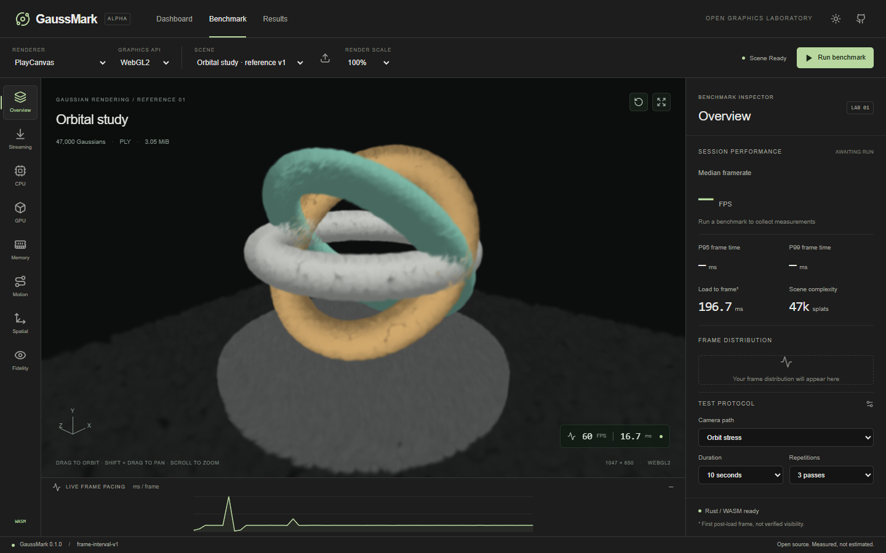

# GaussMark

[](package.json)
[](LICENSE)
[](#run-locally)
[](package.json)
[](#what-works)
[](#rebuild-the-rustwasm-module)

A working, local-first Gaussian rendering laboratory. Next.js / React / TypeScript, PlayCanvas, Rust / WebAssembly, and a Cloudflare Workers / D1 results service. MIT licensed.



## Run locally

Node.js 22.16+ and npm are required. Chrome or Edge with hardware acceleration is recommended. The reference scene and built WASM files are included; Rust is only necessary when rebuilding the portable core.

From Git Bash on Windows:

```bash
cd /d/Personal/Projects/GaussMark
npm ci
npm run db:migrate
npm run dev
```

Open **http://127.0.0.1:3005**. The local Worker API uses **http://127.0.0.1:3015**. No Cloudflare credentials or environment variables are required for local use. Ports 3000 and 8787 are intentionally avoided.

For representative measurements, use the production build instead of the development server:

```bash
# Stop npm run dev first, then:
npm run build
npm run preview
```

Open **http://127.0.0.1:3015**. This serves the exported frontend and Worker API together, with persistent local D1 storage. `npm run build` does not deploy anything.

## What works

- Compact dashboard, benchmark workspace and results archive; light/dark themes with saved preference; mobile inspector drawer.
- Actual PlayCanvas 2.23.3 Gaussian rendering on **WebGL2 and WebGPU**, plus pinned WebSplatter on **WebGPU** (binary little-endian Gaussian PLY). Automatic API fallback is rejected to preserve truthful metadata.
- A reproducible, original 47,000-Gaussian reference scene (`Orbital study v1`, 3.05 MiB), MIT licensed. No external asset request is needed.
- Local Gaussian PLY and SOG input, file picker and drag/drop. Local files are never uploaded. Mesh PLY and compressed PLY are excluded by this first version's input guard. Limit: 256 MiB.
- Renderer-specific camera navigation, scroll zoom, WASD movement, draggable XYZ rotation gizmos, reset, fullscreen, and 50/100/150% render scale. Render scale is relative to CSS viewport dimensions, capped independently of device pixel ratio.
- Stationary, slow, fast, and orbit camera protocols; 2-second warm-up, 5/10/20-second measured passes, 1 or 3 repetitions.
- Real renderer-frame intervals; Rust/WASM median, interpolated P95/P99, mean, variance, min/max and per-pass statistics. Raw data is preserved in JSON exports.
- Load lifecycle waterfall, asset bytes, scene complexity and optional Chromium JS heap snapshots. Unavailable metrics are explicitly labelled.
- Validated WGS84 → ECEF computation: 50,000 Float64 points, equivalent TypeScript/WASM batches, six alternating repetitions, analytic reference cases, and numerical error checks.
- Last 20 local sessions, session reports, full JSON export, and persistent A/B slots with file/settings checks and side-by-side metrics.
- Optional submission with a complete technical preview and explicit checkbox. Real results API, D1 persistence, aggregates, filters, sortable table, and 30-second dashboard refresh.
- Reference/custom workloads remain separated. No fabricated submissions, demo numbers, or universal benchmark score.

## Saved A/B comparisons and scene controls

Drag the red/green/blue **rotation rings** directly in the viewport to rotate the object around X/Y/Z. Hold Shift to snap to 15 degrees. The **Rotate object** toolbar button shows/hides the rings; **Reset view** clears rotation and reframes. Focus a ring and press arrow keys for precise 1-degree steps (Shift: 15 degrees).

Click the viewport to focus it; movement works without a Fly-mode selector. **PlayCanvas:** WASD to move, Q/E down/up, right drag to look, left drag to orbit, middle or Shift+left drag to pan, F to frame. **WebSplatter:** WASD to move, Space/Ctrl up/down, Q/E camera roll, left drag to look, right drag to pan, R to reset, backtick to capture/release the mouse and Esc to release. Shift speeds up movement in both. The WebSplatter bindings follow the [pinned upstream controller](https://github.com/websplatter/WebSplatter/blob/16bb06e86b8fb12193d4bb4cd2b0b3d4f3ab62be/src/camera-control.ts).

**Scene controls** now displays a read-only hotkey reference for the active renderer. Rotation gizmos are GaussMark editor tools shared by both adapters, not an embedded renderer editor. They are hidden and disabled during measurement; object rotation is saved with the result. Inspection navigation, including WebSplatter camera roll, cannot change the automated benchmark path.

1. Load your PLY, choose PlayCanvas and run a benchmark.
2. Click **Save as A**. This keeps the full result independently of the rolling 20-session archive.
3. Choose WebSplatter. The same local file remains loaded. Click **Use saved A’s test settings** to copy the protocol, rotation and exact render-target dimensions.
4. Run and **Save as B**, then **Compare A/B**. Results also lets you open older local session reports and save them into either slot.
5. The comparison survives page reloads in the same browser/origin. Slots are replaced only when you save another result into them; export JSON for a portable copy. The actual local scene file is not persisted, so reload it after navigating away.

Different files, durations, paths, rotations, resolutions or environments are flagged, and percentage comparisons are hidden. Custom file hashes are used locally and removed from community submissions.

## Controls and measurement

Select a scene/API, then choose a protocol in Overview or Motion. Run locks configuration and camera interaction until completion. Stop, tab hiding, and window resizing cancel the run without saving a partial result. Switch categories without replacing the viewport.

Frame intervals measure browser scheduling plus rendering and are often display-refresh-limited. They are **not GPU execution timings**. The live readout is a recent interval; report FPS is `1000 / median(frame interval)`. The workload is deliberately small, so a fast GPU will often reach the display pacing limit. Close competing GPU workloads for useful comparisons.

See [measurement conventions](docs/methodology.md) for the exact protocol and limitations.

## Rebuild the Rust/WASM module

Install Rust through rustup, plus the platform's native compiler/linker (Visual Studio C++ Build Tools on Windows). Then:

```bash
rustup target add wasm32-unknown-unknown
npm run test:rust
npm run build:wasm
```

The crate produces both `rlib` / native `cdylib` and browser WASM. `wasm-pack` and wasm-bindgen are build tooling; the browser module loads from `public/wasm/`. Generated WASM and JS are checked in for a quick local start. Rust sources and `Cargo.lock` are retained for reproducibility.

Regenerate the original Gaussian scene with `npm run scene`. Its manifest includes a SHA-256 digest, seed, version, count and byte size. Regeneration must produce the same digest for v1.

## Environment and database

| Setting               | Local use                                                          | Hosted use                                                 |
| --------------------- | ------------------------------------------------------------------ | ---------------------------------------------------------- |
| `NEXT_PUBLIC_API_URL` | Optional build-time override; defaults to port 3015 in development | Omit for same-origin API                                   |
| `DB`                  | Wrangler creates a local D1 binding                                | Set a real D1 database ID in `wrangler.jsonc`              |
| `RATE_LIMIT_SALT`     | Fixed local-only salt                                              | Required Worker secret; submission fails closed if missing |

`npm run db:migrate` applies `migrations/0001_results.sql` **locally**. Local records live under `.wrangler/state/`, which is ignored by Git. The wrapper keeps emulator configuration/logs inside `.wrangler/` and disables Wrangler telemetry. No login is needed.

The frontend is a static Next.js export under `out/`; the Worker serves assets and `/api/results`. This avoids a server-rendering adapter and is compatible with Cloudflare's static asset + Worker + D1 architecture and free-tier limits for a small deployment. Actual usage remains subject to Cloudflare quotas.

**No cloud resources have been created and nothing has been deployed.** When deployment is authorized: create a D1 database, replace the placeholder database ID, configure `RATE_LIMIT_SALT` with `wrangler secret put`, apply migrations with `--remote`, build, and deploy with Wrangler. Do not use the all-zero local database ID remotely. Review [deployment and API notes](docs/architecture.md) first.

## Validation

```bash
npm test
npm run test:rust
npm run typecheck
npm run build
npm run test:e2e
```

Browser tests use an installed Chrome, run serially to avoid competing measurements, and use port 3005 by default. For production validation, start `npm run preview` and run from Git Bash:

```bash
TEST_BASE_URL=http://127.0.0.1:3015 TEST_NO_SERVER=1 npm run test:e2e
```

The submission test writes **genuine measured results to the local API only** and exercises the ten-per-hour limit. Use an isolated, fresh emulator directory for repeated full-suite runs:

```bash
node scripts/wrangler.mjs d1 migrations apply gaussmark --local --persist-to .wrangler/test-state-RUN
node scripts/wrangler.mjs dev --ip 127.0.0.1 --port 3015 --persist-to .wrangler/test-state-RUN
```

Replace `RUN` with a new name each time; stop the normal preview before starting this test preview. Do not delete your normal local database to reset tests.

See [validation evidence](docs/validation.md) and [screenshots](docs/screenshots/). `npm run format` formats TypeScript, TSX, CSS and configuration.

## Architecture

| Module                        | Responsibility                                                                                |
| ----------------------------- | --------------------------------------------------------------------------------------------- |
| `src/app/`                    | Static routes and semantic theme tokens; Tailwind CSS integration                             |
| `src/components/`             | Workspace, charts, reports, dashboard and archive                                             |
| `src/core/runner.ts`          | Renderer-independent phases, repeatable camera progression, frame collection and cancellation |
| `src/core/wasm.ts`            | Batched statistics and spatial workloads across the WASM boundary                             |
| `src/renderers/playcanvas.ts` | Device, assets, camera controls, frame events and resource disposal                           |
| `crates/gaussmark-core/`      | Native/browser statistics and geodetic mathematics, no browser APIs                           |
| `worker/`, `migrations/`      | Validated compact records, D1 queries and submission rate limiting                            |
| `scripts/generate-scene.mjs`  | Original, deterministic Gaussian reference asset                                              |

## Known limits and next priorities

1. **WebSplatter requires WebGPU and binary little-endian Gaussian PLY.** SOG remains PlayCanvas-only. The pinned source and renderer differences are documented in [WebSplatter integration notes](docs/websplatter.md). Matched workloads do not guarantee equivalent visual quality.
2. GPU timestamp queries, sort/compute timings, progressive loading, decode-only measurements, true first-splat visibility, buffer peaks and retained allocation tracking are not implemented. The heap view is partial, not total system RAM/VRAM.
3. Fidelity is an honest planned state. No PSNR/SSIM pipeline or quality score exists.
4. The dashboard's charts describe at most the latest 200 matching records. Trends currently show submission activity; controlled performance trends, pagination, richer selection and chart zoom remain future work.
5. The reference asset is a procedural Gaussian sculpture, not a reconstructed scan. Add larger licensed scenes, workload presets and fixed render-target presets next.
6. Only Chromium on this Windows host was tested. Both graphics APIs worked here; Firefox/Safari/native platforms, mobile devices and SOG loading still need a compatibility matrix. Small-screen layout was emulated in Chrome.
7. Community records are self-reported, not independently attested. The hashed-IP hourly limit is basic abuse protection, not bot resistance. Add Turnstile, deployment-level rate limiting and a retention policy before broad public use.
8. Spatial work covers forward WGS84 geodetic-to-ECEF only. ENU, UTM, inverse conversions, general transforms and frustum benchmarks are not implemented.

Dependency licenses are recorded in [third-party notices](THIRD_PARTY_NOTICES.md). Existing repository license and Git history were preserved; no commit or push was made.


## Interior camera setup and local filenames

Local reports and exports now keep the uploaded filename. Previously anonymized historical results cannot recover that name; run the file again. Public community payloads still use `Local scene`.

In Overview or Motion, choose **Camera setup → Interior circle**. The gold center defines the grid origin; drag it along the grid or edit X/Y/Z. Drag the gold circumference or edit Radius. Adjust Camera height above the grid and Start angle. Values are scene units, not necessarily metres. Existing XYZ rotation rings let you orient the scene relative to this horizontal grid. Use Preview saved camera to inspect the start from inside the room; select Orbit stress for one full inward-facing circle. Slow/fast use the same circle with 0.28/1.5 turns. The route keeps a constant radius and height and does not auto-frame the building.

Choose **Freeze current view** to capture the exact position, target and up vector for a stationary measurement. **Save setup / Restore setup** retains the camera setup and object rotation in this browser, keyed by file hash. Re-load the file after page reload and restore its setup. Camera setups are included in results, exported JSON and saved A/B settings; different paths trigger a comparison mismatch. Every run restores the inspection camera afterward. Guides disappear during timing. The grid is a placement guide, not a collision detector; preview and inspect the route to ensure it remains inside walls.
